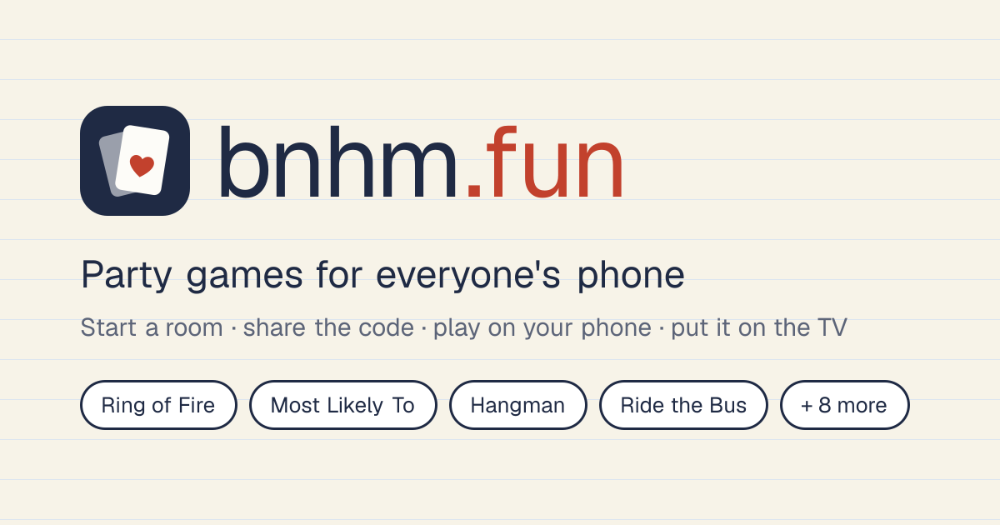

<p align="center">
  
</p>

<p align="center">
  <b>Party games for everyone's phone.</b><br>
  Start a room, share the code, and everyone plays on their own phone. Put it on the TV too.
</p>

<p align="center">
  <a href="#quick-start">Quick start</a> ·
  <a href="#games">Games</a> ·
  <a href="#themes">Themes</a> ·
  <a href="#hosting-docker">Hosting</a> ·
  <a href="#how-it-works">How it works</a>
</p>

---

**bnhm.fun** is a self-hosted party-game app. One person starts a room and gets a 4-letter code. Everyone joins on their own phone with a name, an optional photo, and optionally guy or girl (used by the Guys and Girls cards). The game runs in real time across every phone and an optional TV screen. Phones buzz and go red when it's your turn to drink.

Built with **Next.js 16**, **React 19**, **Tailwind CSS 4** and **Bun**. There's no database, no accounts and no tracking.

## Highlights

- **11 room games with a TV screen.** Party games: Spotlight (secret votes in themed packs), Punchline (write the funniest answer), Bluff (fake answers to weird facts), Odd One Out (find the faker), Most Likely To, Trivia and Hangman. Drinking games: Ring of Fire, Never Have I Ever, Truth or Drink and Higher or Lower. Join with a code or a **QR code**; open the TV / admin screen on a big display.
- **Easy flow:** pick a game → read three steps and set options → start. Switch the whole room to another game when one ends, without anyone rejoining.
- **Solo puzzles:** Six Tries (make a word puzzle from your own word, share the link, see everyone's results) and Mini Grid crosswords.
- **Party extras:** emoji reactions that float up on the TV, an end-of-game recap with awards, and an optional turn timer.
- **Never lose your seat:** a 4-digit rejoin PIN gets you back in from a new phone, and the host can hand over host controls. Rooms survive restarts and redeploys with Redis.
- **Your phone knows when you drink:** a full-screen alert with the reason, confirmed with *Done*. The next card waits until everyone has drunk.
- **Ring of Fire extras:** mates that chain, a question master, Jack rules with phone votes to scrap them, and host toggles for individual cards (e.g. no King's cup).
- **Admin from any device:** each room gets a secure admin password, so you can unlock host controls on a TV or a second phone.
- **25 game modes in total:** the room games, plus pass-the-phone card games (Higher or Lower, Ride the Bus, Pyramid, Beat the Dealer, Horse Race, and more) and a card dealer with private hand links.
- **Rules for every game** at `/how-to-play`, linked from each game.
- **Settings per device:** text size, keep screen awake, vibration, sounds, animations, and Drink/Forfeit wording for non-drinking groups.
- **8 themes:** Notebook, Clean, Sunset, Candy, Night, Chalkboard, Ocean and Arcade, with live previews.
- **One-command hosting:** Docker behind your own reverse proxy (a Caddy snippet is included), or an instant public link through a Cloudflare tunnel. Rate limits and security headers are built in.

> The drinking games are for adults. Anyone can swap drinks for water or forfeits, and look after each other.

## Quick start

```bash
bun install
bun dev
```

Open <http://localhost:3000>. To play with friends on the same Wi-Fi, have them open the **Network** URL that `bun dev` prints (e.g. `http://192.168.1.20:3000`). `next.config.ts` adds this machine's LAN IPs to `allowedDevOrigins`; without that, Next's dev server blocks JavaScript for other devices and joining silently fails. If your IP changes, restart `bun dev`.

To test several players on one computer, use separate tabs: each tab keeps its own player.

| Command         | What it does                         |
| --------------- | ------------------------------------ |
| `bun dev`       | Dev server with hot reload           |
| `bun run build` | Production build (standalone output) |
| `bun run start` | Serve the production build           |
| `bun run lint`  | ESLint                               |
| `bun run test`  | Unit tests (game rules, room core)   |
| `bun run test:e2e` | Production build + Playwright end-to-end tests (two phones play a room; TV admin login) |

## Games

Every game has a rules page at `/how-to-play/<game>` (index at `/how-to-play`), linked from its screen.

### Room games: everyone on their own phone

| Game                  | Phones                                                                    | TV / admin panel                                                      |
| --------------------- | ------------------------------------------------------------------------- | --------------------------------------------------------------------- |
| **Spotlight**         | Secret vote: yes/no, or pick one of two players from the room             | Question, the two faces, then growing result bars with who voted       |
| **Punchline**         | Answer two prompts; vote in anonymous face-offs                           | Who's still writing, the face-off, the reveal, a podium                |
| **Bluff**             | Write a fake answer to a weird fact, then pick the truth                  | The fact, all answers, then each lie, its author and who fell for it   |
| **Odd One Out**       | Press-and-hold secret card; vote for the faker; the faker guesses         | Category, speaking order, votes, the verdict                           |
| **Ring of Fire**      | Draw on your turn, read the rule, pick who drinks / your mate / your rule | Big card + rule, whose turn, sips per player, mates, rules, event log |
| **Most Likely To**    | Secret vote for a player                                                  | Card, who's voted, results bar chart                                  |
| **Never Have I Ever** | Secret "I have" / "Never"; the guilty are revealed together              | Prompt, who's answered, the guilty                                    |
| **Truth or Drink**    | Your question pops up on your turn: answer, or drink 2 to dodge           | Whose turn, the question, the outcome                                 |
| **Higher or Lower**   | Call higher / lower / equal on your turn; equal lets you hand out 3       | Big card, whose turn, streak, countdown                               |
| **Trivia**            | Four coloured answers, 20 s, one go each                                  | Question, answers, countdown, live leaderboard                        |
| **Hangman**           | Picker types the word; others guess on a keyboard                         | Stickman, word, missed letters, scores                                |

**Spotlight packs:** Friends, Girls' night, Lads' night, Couples, Work do, Family, Spicy (18+) and Mix it up. Each pack has about 40 questions; a game plays 10, 20 or 30 picked at random, so repeats are rare. Anonymous mode keeps the percentages but hides who voted which way.

**Flow:**

0. On the home page, tap a game. Its setup page shows the three steps and any options (pack, number of questions, turn timer, drinking mode); then **Start a room**.

1. You're the host. Everyone else joins with the code or the QR code.
2. Join your own room with a name and an optional photo. The photo is cropped and shrunk on your device to a 160 px JPEG before upload.
3. Others enter the code on the home page, or open `/r/CODE`.
4. Press **Open TV / admin** to open a popup to drag onto a TV, or open `/tv/CODE` on any screen. Anyone can watch; controls appear only on admin devices.
5. **Admin on another device:** creating a room also creates an **admin password** (e.g. `k7mp-3xq9-hr2w`). It's shown to the host in the lobby and under Menu. On a TV or second device, open `/tv`, enter the code and password (or use **Admin login** on `/tv/CODE`), and that device gets host controls. Case, spaces and dashes don't matter when typing it.

**In every room:**

- **QR code to join:** on the TV next to the room code, and in each phone's Menu.
- **Rejoin PIN:** everyone has a 4-digit PIN in their Menu. On a new phone, open the room link, tap *Rejoin*, pick your name and enter the PIN. Five wrong tries lock that seat for a while.
- **Host handover:** the host can tap *make host* on any player. Host rights follow that player, and the admin password rotates, so old admin screens drop off.
- **Reactions:** an emoji bar at the bottom of every phone. Reactions float up on the TV with the sender's photo.
- **Switch game:** Menu → *Switch game*, or the *What's next* panel when a game ends. The whole room moves to the new game with everyone still in it.
- **Recap & stats:** Menu → *Game recap & stats* shows awards (Thirstiest, Stayed dry, Most picked on) and a sips table, with a *Share the results* button. The host can put the recap full-screen on the TV.
- **Turn timer** (Ring of Fire, Higher or Lower): Off, 15, 30 or 60 s, set by the host. Running out skips the turn; it pauses while anyone is still drinking.

**Drinking alerts:** when a game says someone drinks, that player's phone shows a full-screen **Drink!** with the reason, and vibrates where supported. It stays until they tap **Done — I drank**. The next card (Ring of Fire) or prompt (Most Likely To) is blocked on the server until every pending drink is confirmed. Everyone sees who they're waiting on, the host has a **Stop waiting** override, and players who leave are cleared automatically.

**Ring of Fire specifics:**

- The drawer chooses on their phone: who drinks (2, 4, 7, 9, 10), everyone who drinks (5, 6), their mate (8), or a new rule (J). The host can choose for them from the admin panel.
- **Mates / drinking partners:** pick one with an 8, or the host sets partners at any time (lobby, Menu, or Partners on the admin panel), one way or both ways. They chain: if Sam's mate is Jo and Jo's mate is Alex, then when Sam drinks, all three phones go off. You can't pick the same mate twice; if you're already paired with everyone, an 8 just passes.
- **Question master:** has buttons on their phone to catch anyone who answers them.
- **Rules (Jack):** the drawer either makes a new rule *or* calls a phone vote to scrap an existing one (majority yes removes it; the game waits for the vote). The host can remove any rule from their phone or the TV.
- **Host controls:** remove rules, close a vote early, turn individual cards on or off (e.g. no King's cup), draw for someone, skip a turn, make anyone drink, remove players, reset.

### Pass-the-phone games (`/party`)


Every game uses a seeded shuffle, so the URL holds the whole game state: deck, cards drawn, guesses and players. **Copy game link** lets others follow along on their phones, and refreshing never loses your place. Adding player names is optional; with names, the game tracks whose turn it is.

| Game                  | How to play                                                                                                                                                                                                       |
| --------------------- | ----------------------------------------------------------------------------------------------------------------------------------------------------------------------------------------------------------------- |
| **Ring of Fire**      | Draw a card and follow its rule (A Waterfall · 2 You · 3 Me · 4 Floor · 5 Guys · 6 Girls · 7 Heaven · 8 Mate · 9 Rhyme · 10 Categories · J Make a rule · Q Question master · K King's cup). Each card shows step-by-step instructions and an example. The 4th King drinks the cup. |
| **Higher or Lower**   | Call the next card **higher**, **lower** or **equal** (Aces low). Miss and you drink one per card in your streak, then pass on. A tie only wins on an equal call, and a correct equal call lets you hand out 3. |
| **Ride the Bus**      | Make four calls in a row: red/black → higher/lower → inside/outside → suit. A miss at step *n* means you drink *n* and start over. Each step explains what counts as a win, using the cards on the table. |
| **Pyramid**           | Everyone is dealt 4 cards to memorise (2–9 players). Fifteen cards are flipped from the bottom row up. If you hold the same rank, you give out drinks equal to the row number (1–5). At the end, forget a card, drink one. |
| **Beat the Dealer**   | Guess the rank of the dealer's next card. Right first time: the dealer drinks 4. Otherwise you're told higher or lower; right on the second go: the dealer drinks 2. Wrong again: you drink the gap. After 3 misses in a row, the deck passes. |
| **Horse Race**        | Bet sips on a suit. Each card drawn moves that suit's Ace forward; track cards flip and knock horses back. Backers of the winner hand out double their bet, and everyone else drinks theirs. |
| **Never Have I Ever** | Read the card. Anyone who has done it drinks. |
| **Most Likely To**    | Everyone points on three. One sip per finger pointing at you. |
| **Truth or Drink**    | Answer the question honestly, or drink to skip it. |
| **Would You Rather**  | Everyone picks a side on three. The smaller side drinks; on a tie, everyone drinks. |

The drinking games are for adults. Anyone can swap drinks for water or forfeits.

### Card dealer (`/cards`)

Enter player names (up to 10) and cards per hand, then **Deal**. You get:

- a **table link** that shows every hand
- a **private link** for each player, showing only their hand behind a *Reveal* button

Anyone who opens the same link sees the same deal. Private links keep people honest at the table, but they aren't truly secret: the table link reveals every hand.

## Settings

The ⚙ button in the bottom-right corner of every screen opens **Settings**. Everything is saved on that device only, and nothing is sent to the server.

| Setting | What it does | Default |
| --- | --- | --- |
| **Theme** | Live previews of all 8 themes (below) | Notebook |
| **Text size** | Normal, Large (112.5%) or Extra large (125%); scales the whole UI, handy on a TV across the room | Normal |
| **Alerts say** | *Drink!* (sips) or *Forfeit!* (points), for groups that aren't drinking | Drink |
| **Keep screen awake** | Holds a screen wake lock so phones and the TV don't sleep mid-game | On |
| **Vibrate** | Buzz when you have to drink or it's your turn | On |
| **Sounds** | A short synthesised chime for drink alerts and your turn (no audio files) | On |
| **Animations** | Card flips, pop-ins and shakes. "Reduce motion" in your system settings also turns these off | On |

Text size and animations are applied before the first paint, like the theme. The code is in `src/lib/settings.ts` (hooks), `src/lib/settings-shared.ts` (defaults and the pre-paint script) and `src/components/settings-panel.tsx`.

## Solo puzzles (`/solo`)

- **Six Tries:** make a puzzle from your own 4–7 letter word and share the link. Everyone gets six guesses; green is the right letter in the right spot, yellow is in the word but elsewhere. The link also shows a **results board** with everyone's score and pattern. The word stays on the server: guesses are scored there, finished results are re-scored there, and the word is only sent once you've finished. Puzzles are kept in Redis for 60 days (memory without Redis). Any letters are accepted as guesses; there's no dictionary check.
- **Mini Grid:** 10 small crosswords (5×5 and 4×4). Tap a cell to pick it, tap again to switch direction, type to fill, and arrows, backspace, Enter and Tab work. There's Check / Reveal, a timer, and a best time per puzzle (help doesn't count). The grids were filled by a search over a list of common English words, so every across and down entry is an everyday word; the clues are hand-written.

## Themes

Pick a theme in **Settings**, which shows live previews. The choice is per device, remembered, and applied before the first paint, so there's no flash.

| Theme | Look | Heading font |
| --- | --- | --- |
| **Notebook** (default) | Ruled paper and a red margin line | Caveat |
| **Clean** | Minimal light grey, crisp | Geist |
| **Sunset** | Warm peach-to-coral gradient, rounder corners | Pacifico |
| **Candy** | Pastel bubbles, polka dots, pillowy corners, bouncy buttons; rounded body font too | Fredoka + Baloo 2 |
| **Night** | Dark with neon pink and green; glowing headings | Fredoka |
| **Chalkboard** | Dusty green board with chalk smudges and a wooden frame | Gochi Hand |
| **Ocean** | Deep blue, teal glow, soft waves | Baloo 2 |
| **Arcade** | Black grid, CRT scanlines, pixel headings, square corners, monospace body | VT323 + Geist Mono |

**How it works:** each theme is one `[data-theme="…"]` block in `src/app/globals.css`. It sets colours (`paper`, `surface`, `ink`, `faint`, `miss`, `hit`, `card-back`), fonts (`--hand-font`, `--body-font`), corner radii (Tailwind's `--radius-*`), and a background (`--bg`). Optional flourishes such as glow and scanlines live in the same file. Theme fonts aren't preloaded, so they only download when someone picks that theme. Playing cards keep real card colours everywhere. To add a theme, add a CSS block and an entry in `src/lib/themes.ts`; the picker preview renders it automatically. Animations are cut for anyone with "reduce motion" turned on.

## Hosting (Docker)

All settings are optional. Copy `.env.example` to `.env` to change them.

| Command                  | What you get                                                                    |
| ------------------------ | ------------------------------------------------------------------------------- |
| `bun run docker:up`      | Production app on <http://localhost:3000> (or `PORT`)                           |
| `bun run docker:tunnel`  | Public `https://….trycloudflare.com` URL via Cloudflare; no domain, account or port-forwarding needed. Prints the URL |
| `bun run docker:dev`     | Dev server with hot reload; your source is mounted into the container           |
| `bun run docker:logs`    | Follow the app logs                                                              |
| `bun run docker:down`    | Stop everything                                                                  |

These wrap plain `docker compose` commands (see `package.json`).

**Files**

| File                      | Purpose                                                                                     |
| ------------------------- | ------------------------------------------------------------------------------------------- |
| `Dockerfile`              | Multi-stage build: Bun installs dependencies, Node runs `next build` (Bun's build can segfault on some x86 hosts), then Next's standalone server runs on `node:22-alpine` as a non-root user. Tested on amd64 and arm64 |
| `docker-compose.yml`      | `app` + `redis` services (health checks, log rotation, restart policy) plus an optional `tunnel` service (Cloudflare) |
| `docker-compose.dev.yml`  | Hot-reload dev container                                                                     |
| `docker/Caddyfile.example` | Site block to paste into **your own** Caddy. The live-update stream (`/api/rooms/*/stream`) is never buffered or compressed |
| `docker/Dockerfile.dev`   | Dev image                                                                                    |
| `.env.example`            | `PORT`, `BIND`, `NEXT_PUBLIC_SITE_URL`, `REDIS_URL`, `STATS_KEY`, `ALLOWED_DEV_ORIGINS`      |

**Making it public: pick one**

1. **Instant public link:** `bun run docker:tunnel` prints a `https://random-words.trycloudflare.com` URL that anyone can open. It's good for a party at someone else's house, and the URL changes each time. Quick tunnels buffer live streams, so the app automatically falls back to polling every 1.5 s. It's tested and works, just slightly less instant.
2. **Your own domain via Cloudflare:** create a named tunnel in the Cloudflare dashboard and swap the `tunnel` service's command for `tunnel --no-autoupdate run --token <token>`. That gives a permanent URL with full live streaming.
3. **Your own server behind your existing Caddy:** see below.

**Behind your existing Caddy:** the compose file only runs the app; HTTPS is your proxy's job.

1. In `.env`, set `BIND=127.0.0.1` if Caddy runs on the same machine, so port 3000 isn't open to the internet. Also set `NEXT_PUBLIC_SITE_URL=https://your.domain`.
2. Run `bun run docker:up`.
3. Paste the site block from [`docker/Caddyfile.example`](docker/Caddyfile.example) into your Caddyfile. Change the domain, and the upstream if needed (`localhost:3000` for Caddy on the same host; the container name if Caddy is in Docker on a shared network). Then run `caddy reload`.

The important part is `flush_interval -1` on `/api/rooms/*/stream`, which keeps live updates instant. Without it, phones still work but drop back to polling. Caddy already sends `X-Forwarded-For`, which the rate limits use to see real client IPs.

**Persistent rooms (Redis):** `docker compose` runs `redis:7` alongside the app. Rooms are saved a moment after every change, loaded back on startup, and timers are re-armed, so a restart or redeploy doesn't end anyone's game. Data lives in the `redis_data` volume, capped at 256 MB. Set `REDIS_URL=` (empty) in `.env` to go back to memory-only. For `bun dev`, point `REDIS_URL` at any Redis.

**Usage stats:** set `STATS_KEY` in `.env`, then open `/stats` and enter it. You'll see live rooms and players, today's and all-time counts (rooms created, players joined, games started, reactions), a 14-day chart and the most-played games. There are no cookies, no IPs and no player data: just counters, stored in Redis when available.

**Health check:** `GET /api/health` returns `{ ok, rooms, uptime }`. Docker uses it to mark the container healthy, and the tunnel waits for it before starting.

**Dev container and phones:** inside Docker, the dev server can't see your computer's Wi-Fi IP. Set `ALLOWED_DEV_ORIGINS=192.168.x.x` (your IP) in `.env` so phones can load it. The production image doesn't need this.

**Built-in protection for public hosting** (in `src/lib/rooms/limits.ts`):

| Limit | Value |
| --- | --- |
| Rooms created per IP | 15 per 10 min |
| Joins per IP | 30 per 10 min |
| Admin-password attempts per IP | 10 per 10 min, plus the per-room lockout |
| Actions per IP | 240 per min |
| Room lookups per IP | 60 per min (stops code scanning) |
| Rooms in total | 500 |
| Screens per room | 64 |
| Request body | 200 KB |

Security headers are set (`X-Frame-Options`, `nosniff`, `Referrer-Policy`, `Permissions-Policy`), and `X-Powered-By` is removed. Client IPs come from `CF-Connecting-IP` / `X-Forwarded-For`, so keep the app behind your proxy or the tunnel (with `BIND=127.0.0.1` when the proxy is on the same host) rather than exposing port 3000 directly.

> **Run exactly one `app` container.** Live connections are per process, so extra replicas would split players across instances. Rooms themselves are safe in Redis across restarts. The pass-the-phone games are unaffected, because their state lives in the URL.

## How it works

```
src/
├── app/
│   ├── page.tsx                    home: join with code / start a room
│   ├── r/[code]/                   player screen (join form → game)
│   ├── tv/[code]/                  TV display + host admin panel
│   ├── how-to-play/                rules index + one page per game
│   ├── api/rooms/                  POST create room
│   ├── api/rooms/[code]/           GET snapshot · POST every action
│   ├── api/rooms/[code]/stream/    Server-Sent Events (live updates)
│   ├── api/rooms/[code]/avatar/    profile pictures
│   ├── party/                      pass-the-phone games (state in URL)
│   └── cards/                      hand dealer
├── games/<game>/{player,tv}.tsx    UI for each room game
├── components/room/                join form, avatar, drink alert, shell
└── lib/
    ├── rooms/core.ts               rooms, players, tokens, presence, drinks
    ├── rooms/games/*.ts            game rules (server-side)
    ├── rooms/registry.ts           kind → game module
    ├── rooms/client.ts             useRoomStream, tokens, avatar resize
    ├── guides.ts                   how-to-play content
    ├── ring-of-fire.ts             card rules shared by both versions
    ├── prompts.ts                  prompt decks
    └── cards.ts                    deck + seeded shuffle
```

- **Real-time:** each screen opens one `EventSource` to `/api/rooms/CODE/stream`. If nothing arrives within 5 s (because a proxy is buffering the stream), it switches to polling `/api/rooms/CODE/state` every 1.5 s. Every action is a `POST`, mutates the in-memory room and pushes a fresh view to every open stream. Presence ("away") is simply "no open stream". The browser reconnects by itself after drops.
- **Admin password:** 12 random characters from an unambiguous 31-letter alphabet (about 59 bits), compared in constant time. After 5 wrong tries the room locks for 30 s, doubling each further miss up to 15 min. It's only ever sent to devices that are already admin. **Change password** issues a new password and a new host token, which signs out every other admin device.
- **Identity:** joining returns a secret player token, kept per tab in `sessionStorage` (so two tabs can be two players) with `localStorage` as a fallback. Creating a room returns a host token, which unlocks admin controls. Other players only ever see public player IDs.
- **Privacy:** views are built per viewer, so the hangman word is only sent to the picker until the round ends.
- **Party games** are fully client-side. A seeded shuffle plus the moves in the URL reproduce the whole game.

### Tests

- `tests/unit/` (`bun test`, 32 tests in about 0.2 s) covers Spotlight packs and anonymous results, Punchline face-offs and scoring, Bluff truth/lie scoring, Odd One Out secrecy and guesses, switching games, Six Tries scoring and secrecy, and Mini Grid clue coverage. It also covers the room core: joining, rejoin PIN lockout, admin password, host handover, drink confirmations, reactions, and a persistence round-trip. It also covers the game rules: disabled cards, turn order, chained mates, Guys/Girls auto-resolve, Jack rule votes, Higher or Lower streaks, Trivia scoring, Never Have I Ever reveals and Truth or Drink turns.
- `tests/e2e/` (Playwright, mobile viewport) runs against the production standalone build. Two separate browser contexts join a Ring of Fire room and play, checking that drink alerts gate the next card. A third test unlocks TV admin controls with the password. If Playwright's browser isn't installed yet, run `bunx playwright install chromium` once.

### Adding a room game

1. Write `src/lib/rooms/games/<name>.ts` that exports a `GameModule` (`init`, `act`, `view`, optional `onJoin` / `onLeave` / `restore`). Call `addDrink()` to buzz someone's phone, `requireDrinksDone()` before moving on, and `schedule()` for timers.
2. Register it in `src/lib/rooms/registry.ts` and add the kind to `GameKind` in `core.ts`.
3. Add the phone and TV views under `src/games/<name>/` (shared pieces such as `GameLobby`, `Countdown` and `PlayerPicker` are in `components/room/game-bits.tsx`), and wire them into `app/r/[code]/room-client.tsx` and `app/tv/[code]/tv-client.tsx`.
4. Add a guide to `src/lib/guides.ts` and a card to `ROOM_GAMES` on the home page.

### Adding a prompt game

Make `src/app/party/<name>/page.tsx` that renders `<PromptGame prompts={[...]} prefix="..." rule="..." intro={...} />` inside `<GameShell>`, and add it to the `GAMES` list in `src/app/party/page.tsx`. `never-have-i-ever/page.tsx` is a working example.

### Scaling beyond one server

Room state is already in Redis, but live connections live in one process. To run several instances, also fan out change notifications through Redis pub/sub (and route each room's writes through one place), so every instance can push to the streams it holds.

## Branding & SEO

The pages themselves carry no logo. The brand appears in the browser tab, link previews, search results and the home-screen icon.

| Asset | Where |
| --- | --- |
| Logo mark: two fanned cards with a heart | `src/lib/brand-art.ts` (source SVG); copy at `docs/logo.svg` |
| Favicon: SVG for modern browsers, plus `favicon.ico` (16/32/48) | `src/app/icon.svg`, `src/app/favicon.ico` |
| App icons 192 / 512, and a maskable 512 for Android | `public/icon-*.png` |
| Apple touch icon (180 px) | `src/app/apple-icon.tsx`, generated with `next/og` |
| Share image (1200×630) | `src/app/opengraph-image.tsx`, generated; copy at `docs/banner.png` |
| Web app manifest (install / add to home screen, with shortcuts) | `src/app/manifest.ts` |
| Name, title, description, keywords, colours | `src/lib/brand.ts` |

Regenerate the PNG and ICO icons after changing the mark with `bun run icons`. Colours: ink `#1f2a44`, paper `#f7f3e8`, accent `#c2412d`.

**SEO**

- **Every page has its own title, description, keywords and canonical URL.** Game and how-to-play pages are built from each game's guide (`src/lib/seo.ts`), e.g. "How to play Pyramid · bnhm.fun".
- **Open Graph and Twitter cards** with the large share image on every page, locale `en_GB`.
- **`/sitemap.xml`** lists the home page, every how-to-play page and every playable game. **`/robots.txt`** points to it and keeps crawlers out of `/r/`, `/tv/` and `/api/`.
- **Room and TV pages are `noindex`**, since they're private and short-lived.
- **JSON-LD structured data** (`WebSite` + free `WebApplication`) in the root layout.

Set `NEXT_PUBLIC_SITE_URL` (default `https://bnhm.fun`) so canonical URLs, the sitemap and share images use your domain. It's baked in at build time and passed through the Docker build.
